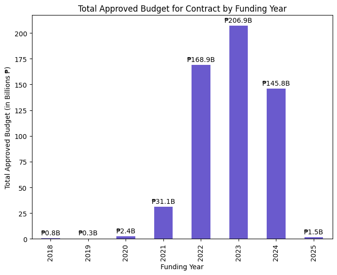
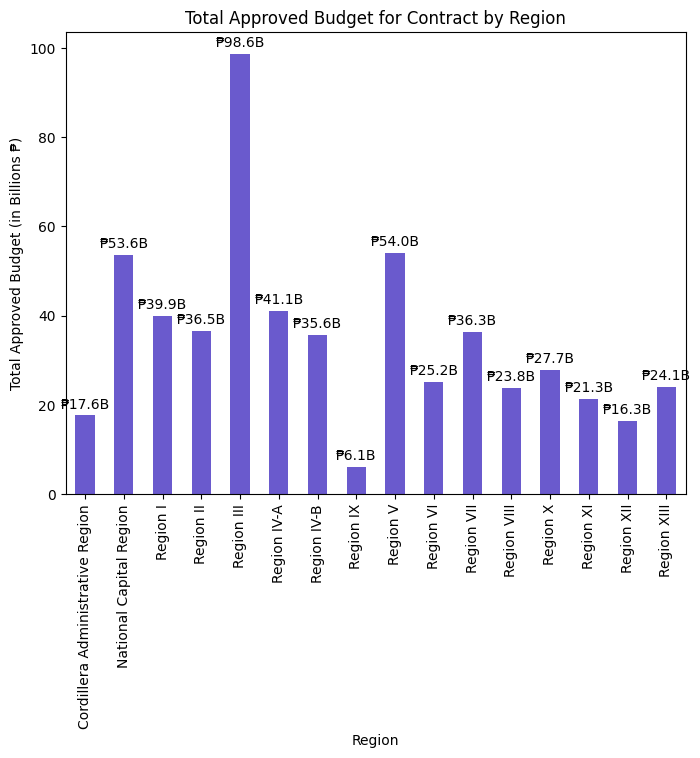
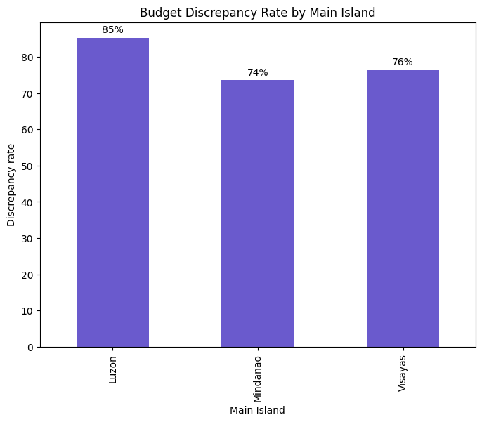
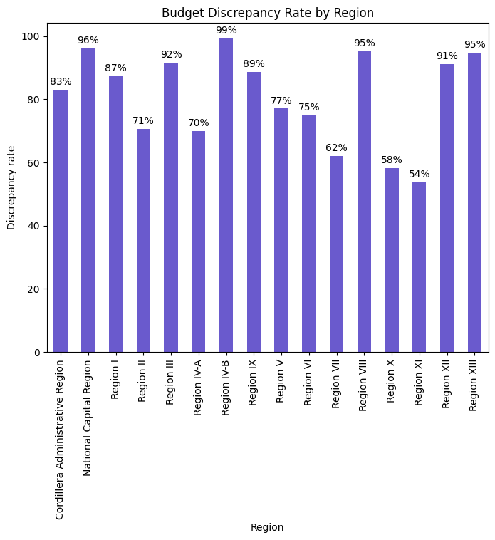

# DPWH Flood Control Procurement Analytics 🇵🇭

Exploratory audit-risk analysis of **9,855 Department of Public Works and Highways (DPWH) flood control contracts (2018–2025)** worth **₱557.7 billion** in approved budgets. I compared each contract's awarded cost against its Approved Budget for the Contract (ABC) to flag budget variances, and broke the results down by year, island group, region, and contractor.

---

## Key Findings

| Metric | Value |
|---|---|
| Contracts analyzed | **9,855** |
| Total Approved Budget (ABC) audited | **₱557.67B** |
| Total awarded Contract Cost | **≈ ₱547.0B** |
| Net variance (Contract Cost − ABC) | **≈ −₱10.66B** |
| Contracts flagged with a budget variance | **8,086 (82.05%)** |
| Peak funding year | **2023 – ₱206.9B** (2,962 flagged contracts) |
| Highest-budget region | **Region III – ₱98.6B** (1,481 flagged, 91.6% rate) |
| Highest variance rate | **Region IV-B (MIMAROPA) – 99.2%** |
| Other high-rate regions | NCR 96.1% · Region VIII 95.2% · Caraga 94.7% |
| Island group with most flags | **Luzon – 5,716 contracts (85.3%)**, ₱376.9B ABC |
| Most frequent contractor | Legacy Construction Corp. – 133 contracts |
| Avg. project duration | 248 days (median 228; max 2,012) |

> **Note:** `hasBudgetDiscrepancy` is an **audit-risk indicator** that flags contracts whose awarded cost differs from the ABC. It points to where a closer look is warranted. It is **not** proof of irregularity or corruption.

## Visuals

| | |
|---|---|
|  |  |
|  |  |

There is also an interactive Plotly scatter plot of **Project Duration vs. ABC**, colored by discrepancy flag, with hover details for each project, region, and contractor. Open the notebook in Colab to explore it.

## Methodology

1. **Data**: [DPWH Flood Control Projects – Philippines (Kaggle)](https://www.kaggle.com/datasets/aquilarozeusazores/dpwh-flood-control-projects-philippines), 9,855 rows × 22 columns, loaded with `kagglehub`.
2. **Cleaning**: dropped `Municipality` (666 missing, can't be imputed); converted ABC and Contract Cost from text to numbers and filled missing values with the median; parsed dates; confirmed there are 0 duplicate rows.
3. **Feature engineering**: `BudgetDiscrepancy`, `BudgetDiscrepancyPct`, `hasBudgetDiscrepancy`, and `ProjectDuration` (completion date minus start date).
4. **Analysis**: group-by aggregations of budget and variance rate by year, island, region, and contractor; bar charts in Matplotlib; interactive scatter in Plotly.

## Buddy 9

Joana Paula Acebedo · Jhade Cuizon · Matt Angelo La Rosa · Alezandra Zandy Torres · Gabriel Sjoerd Saratan

**Tech:** Python, pandas, NumPy, Matplotlib, Plotly, Google Colab
